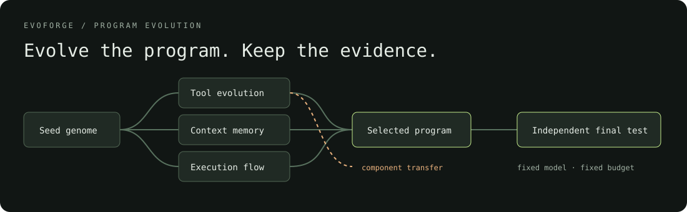

# EvoForge

**Evolve the program. Keep the evidence.**

EvoForge is an experimental framework for coding agents that modify their own source, evaluate the resulting programs, and retain multiple evolutionary branches. Model weights stay fixed. Tool logic, context memory, execution policy, and reusable skills can change.

[中文说明](README.zh-CN.md) · [Architecture](docs/architecture.md) · [Experiment protocol](docs/experiments.md) · [Extension guide](docs/extending.md)



## What it does

- **Self-proposal:** each candidate contains both `step(observation)` and `propose(context)`. Its own proposal function prepares the next mutation, so the mutation mechanism can evolve with the execution loop.
- **Four mutation axes:** tools, memory, workflow, and skills. Every proposal changes one axis, making component reversion experiments possible.
- **Branching archive:** preserve accepted candidates and behaviorally different stepping stones; select parents using a quality/token Pareto frontier and an exploration allocation.
- **Component transfer:** periodically recombine one component from another archived branch and evaluate the entire child.
- **Independent evaluation:** training traces inform proposals; validation selects candidates; a final test evaluates the frozen selection and closes the run.
- **Resource accounting:** fixed per-task step, call, token, and time allowances; a separate run ledger includes proposals, unsuccessful requests, evaluations, and ablations.
- **Evidence:** source snapshots, diffs, task outcomes, paired bootstrap intervals, input mutation checks, component ablations, and an integrity-linked event archive.
- **Observatory:** a standalone HTML report with a clickable lineage graph, source diffs, quality/cost plot, and ablation results. No server or frontend build required.

The current task adapter repairs a single Python implementation file in a small source tree. It supports JSON arguments, return values, exception checks, and optional input preservation checks. The bundled 24-task suite is a small functional fixture across four task families, not a broad repository benchmark.

## Run an offline experiment

Requires Python 3.9+ on macOS or Linux. There are no third-party runtime dependencies.

```bash
git clone https://github.com/Junyi-Zheng/evoforge.git
cd evoforge
PYTHONPATH=src python3 -m evoforge demo --output runs/demo --rounds 9 --ablations --seal
```

Already have the folder? Start with the last command from that folder. Open `runs/demo/report.html` in a browser when it finishes.

For an installed CLI:

```bash
python3 -m venv .venv
source .venv/bin/activate
python -m pip install --upgrade pip
python -m pip install -e .
evoforge demo --output runs/another-demo --rounds 9 --ablations --seal
```

**Demo mode uses explicitly scripted responses and mutation recipes.** It exercises the real execution, selection, archive, and evaluation machinery without credentials. Its scores demonstrate the plumbing, not autonomous learning. The report carries the same distinction.

## Run with a model

Live mode requires Docker and a Chat Completions compatible endpoint that supports JSON responses, `temperature`, and `max_tokens`. All model requests originate in the controller; candidate containers have no model credentials or network access.

```bash
docker build -t evoforge-runtime:local -f runtime/Dockerfile runtime
cp configs/live.json configs/experiment.json
```

Set `model` to a specific model version and `base_url` to the endpoint's `/v1` URL in `configs/experiment.json`. Export its credential through `EVOFORGE_API_KEY`, if required. The default endpoint is local; no cloud account is assumed. Pricing fields are optional and must be filled in for monetary estimates.

```bash
PYTHONPATH=src python3 -m evoforge run --config configs/experiment.json --output runs/experiment
PYTHONPATH=src python3 -m evoforge ablate runs/experiment
PYTHONPATH=src python3 -m evoforge seal runs/experiment
PYTHONPATH=src python3 -m evoforge report runs/experiment
```

Use a new output directory for each experiment. Run-level budgets also cover ablations and the final test; allow room for both. Provider-reported usage is preferred. Missing usage or uncertain failures receive conservative token estimates; this accounting is not a provider billing cap.

The runtime image ID, controller fingerprint, task suite, seed genome, model configuration, and per-task budgets are recorded. Resume requires the recorded runtime and controller source.

## Inspect and resume

```bash
PYTHONPATH=src python3 -m evoforge inspect runs/demo c0004
PYTHONPATH=src python3 -m evoforge audit runs/demo
PYTHONPATH=src python3 -m evoforge resume runs/interrupted-run
PYTHONPATH=src python3 -m evoforge export-suite examples/suite.json
PYTHONPATH=src python3 -m evoforge compare runs/experiment-a runs/experiment-b
```

A completed run can be sealed once. Sealing fixes the selected candidate and disallows further evolution. A repeated `seal` returns the recorded result. Interrupted evaluations may need to repeat, while their earlier costs remain charged. Completed ablation components are reused when `ablate` resumes. Only one process can open a run at a time.

## Project layout

```text
src/evoforge/
  engine.py        evolution, crossover, sealing, component reversions
  evaluation.py    fixed task controller and external grading
  selection.py     Pareto selection, novelty, regression gates
  genome.py        mutation boundaries and source validation
  providers.py     model endpoint adapter and offline fixtures
  sandbox.py       container/process launcher
  worker.py        small isolated runtime protocol
  archive.py       SQLite state, event chain, artifact integrity
  budget.py        durable reservations and usage accounting
  report.py        static report export
  seed/            the initial five-file agent genome
configs/           experiment configuration
docs/              design, protocol, and extension contracts
tests/             controller, accounting, isolation, and lifecycle tests
examples/          shareable offline report
```

## Development

```bash
make test
make demo
# After building the runtime image:
EVOFORGE_DOCKER_TESTS=1 PYTHONPATH=src python3 -m unittest discover -s tests -p 'test_docker.py' -v
```

Read [the experiment protocol](docs/experiments.md) before interpreting scores. In particular, a positive validation gain is a selection signal, not a claim of statistical significance or general intelligence.

## Research context

[Darwin Gödel Machine](https://arxiv.org/abs/2505.22954) motivates program self-modification and retaining an archive of alternative agents. [GEPA](https://arxiv.org/abs/2507.19457) motivates learning from execution traces and evaluating quality/cost trade-offs. [Voyager](https://arxiv.org/abs/2305.16291) motivates accumulating reusable skills.

EvoForge has its own implementation and restricted execution contract. It adds explicit component boundaries, component transfer and reversion, per-task regression gates, sealed evaluation, and a local evidence archive. It does not reproduce the results of those papers. Skills in this version are tagged procedural lessons; executable skill graphs, arbitrary shell tools, weight training, and SWE-bench adapters are outside the current implementation.

## License

MIT. See [LICENSE](LICENSE).
