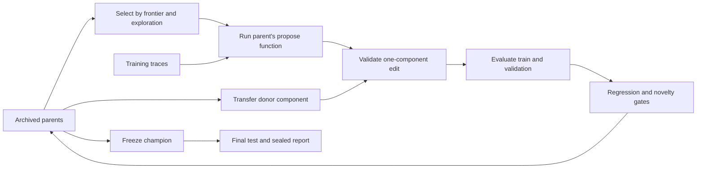

# Architecture

EvoForge treats an agent as an immutable five-file genome. A trusted controller selects a parent, executes its proposal method, validates the proposed edit, evaluates the resulting child, and commits its evidence. Candidate IDs are local archive nodes rather than Git branches; every node has a full source snapshot and parent diff.

## Mutable agent

| File | Responsibility | Mutation axis |
| --- | --- | --- |
| `agent.py` | `step(observation)` and `propose(context)` | workflow |
| `policy.json` | Execution preferences and context allowance | workflow |
| `tools.py` | File selection, request preparation, other pure helpers | tools |
| `memory.py` | Compact execution history into useful context | memory |
| `skills.json` | Tagged reusable procedural lessons | skills |

Each invocation runs in a fresh process. Persistent episode state travels explicitly in `state`; persistent learned behavior lives in the genome. The proposal function can return either a model request or a complete mutation. A workflow mutation may rewrite `propose` itself, enabling recursive changes to the proposal mechanism within the fixed contract.

Genome validation enforces the file manifest, source size, function entry points, component boundaries, a small import set, and structured skill records. AST restrictions reduce accidental contract violations. Docker supplies the actual execution boundary for live experiments; AST validation alone is not a security boundary.

## Fixed controller

The controller owns the task split, evaluator, expected results, selection algorithm, credentials, budget ledger, source archive, and worker protocol. Those are not genome components. Changing the controller creates a new experiment; its fingerprint prevents continuing an old run under silently changed semantics.

The action set is `list_files`, `read_file`, `search`, `write_file`, `run_tests`, `ask_model`, and `finish`. An agent can change how it chooses and combines these actions. Only the task's designated implementation target is writable through the action broker. Arbitrary shell commands and new host capabilities are not exposed.

## Selection

The first three rounds branch from the seed to explore tools, memory, and workflow independently. Later rounds draw parents either from the success/token Pareto frontier or from all eligible candidates with inverse-offspring weights. Behavioral novelty is the minimum weighted distance to archived nodes: 80% task-family success differences and 20% component fingerprint differences.

A candidate is `accepted` when its mean validation gain reaches `min_gain` and the fraction of regressed tasks stays within `regression_tolerance`. Default values allow ties but no per-task regression. A failed gate can still yield a `stepping_stone` if novelty is at least 0.1. Other candidates remain archived as `rejected` and cannot become parents. Champion selection considers seeds and accepted candidates, preferring higher validation success, then lower token cost.

Every fifth round can transfer a component from another accepted or stepping-stone branch. The child is fully re-evaluated; a good donor component is not presumed compatible with its recipient.

## Execution boundary

Live genomes and submitted solutions run separately. Each container receives the worker program and a bounded source snapshot over its command/input protocol; no host directories or Docker socket are mounted. It runs as UID/GID 65534, with no network, a read-only root filesystem, a bounded temporary filesystem, no Linux capabilities, and limits on processes, CPU, memory, open files, and output. Model requests happen outside the container. A Docker image ID is resolved once and used for the run.

The worker materializes the source snapshot in the container's temporary filesystem with read-only file permissions. The executing user owns those temporary files and can change their permissions; that is not the isolation boundary. Changes die with the invocation and cannot alter the host's genome, task workspace, or later grading snapshot. Only controller-mediated actions persist task edits.

Final grading sends input arguments to the solution worker and compares returned values against expected results in the host evaluator. Private expected values are never mounted or sent to the candidate. An input preservation check also compares arguments before and after execution. Containers share the host Docker kernel boundary; this is a research runtime, not a claim of protection against kernel exploits or every adversarial Python introspection technique.

Local mode runs only bundled, trusted demo fixtures and does not provide filesystem isolation. The CLI rejects custom genomes or suites in local mode.

## Persistence

SQLite stores the authoritative state and an ordered hash-linked event log. The archive uses WAL, full synchronization, a process lock, and atomic JSON writes. Each model call receives a persisted reservation before dispatch. A response replaces it with actual usage when available. Crashes retain the pending reservation as conservative consumed budget.

Source and evaluation files carry content fingerprints. `audit` verifies the event head, current controller, suite, candidate files, score summaries, and sealed artifacts. This detects local corruption relative to the recorded history; it is not an externally signed provenance system.

Interrupted uncommitted artifacts move to `abandoned/` before retry. Completed candidates and completed ablation components are reused. The final-test state closes evolution before evaluation begins; an interrupted final test can be retried for the same candidate. No final-test outcome is passed to proposal or selection.
